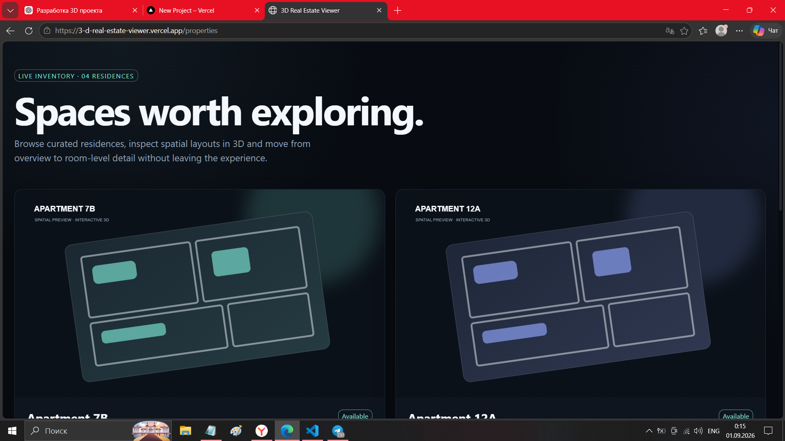
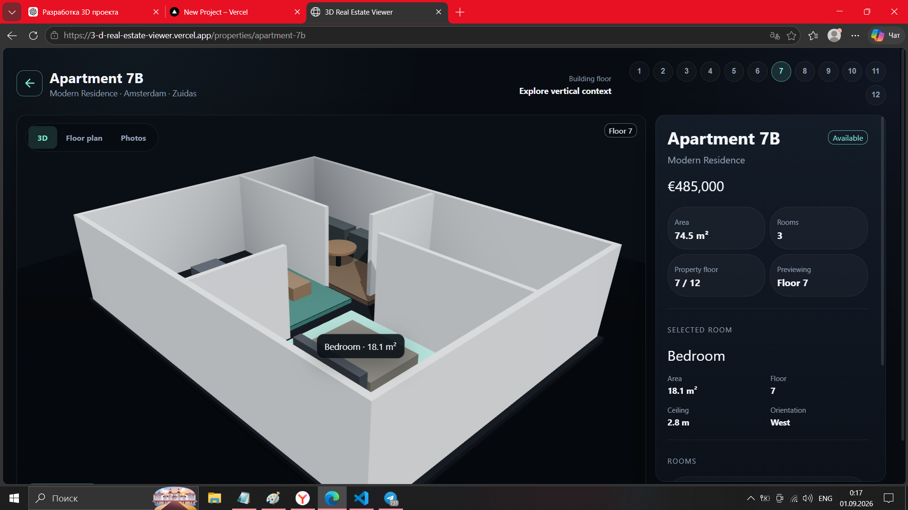
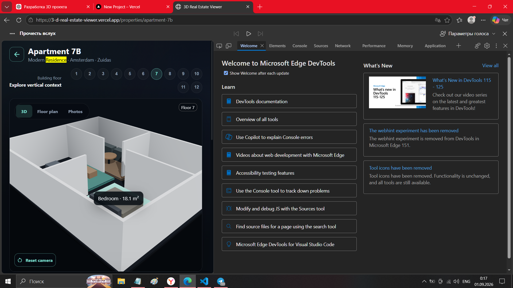

# 🏠 3D Real Estate Viewer

Interactive 3D real estate platform built with React, TypeScript and Three.js.

The application allows users to explore apartments in an immersive 3D environment, inspect rooms, view floor plans and browse property information.

---

## ✨ Features

### 🏢 Property Catalog

- Browse available apartments
- View property details
- Price, area, floor and room count
- Responsive property cards

### 🌐 Interactive 3D Viewer

- Real-time WebGL rendering
- Orbit camera controls
- Zoom / rotate / pan
- Smooth camera damping
- Lighting and shadows
- Procedural apartment generation

### 🚪 Room Interaction

- Select rooms directly in 3D
- Hover effects
- Highlight selected room
- Room information panel
- Two-way synchronization:
  - 3D → UI
  - UI → 3D

### 🗺 Multiple View Modes

- 3D View
- Floor Plan
- Photos Gallery

### 📱 Responsive Design

Optimized for:

- Desktop
- Tablet
- Mobile

---

# 🛠 Tech Stack

## Frontend

- React
- TypeScript
- Vite
- React Router

## 3D

- Three.js
- React Three Fiber
- Drei

## State Management

- Zustand

## UI

- Material UI
- Emotion

## Code Quality

- ESLint
- Prettier

---

# 🏗 Architecture

The project follows Feature-Sliced Design principles.

## Caspi Yards — симулятор продаж (`/caspi/`)

Статическая страница `public/caspi/index.html`: 3D-квартал (11 корпусов, 2 875 квартир прайса REV19),
подбор, карточка квартиры, окраска «статус / цена ₼/м² / сверка HBT». three.js 0.147 лежит в
`public/caspi/vendor/`, внешних запросов к CDN нет (кроме Google Fonts).

- `units.json` — квартиры прайса REV19; `plans.json` — планы этажей с контурами; `models.json` — GLB корпусов (base64).
- `hbt.json` — поэтажная сверка с квартирографией архитектора `FGR_CPY_HBT_221026.xlsx` (Bina 1/3 в HBT = корпуса 3/1 прайса).
- `renders/` — 23 экстерьерных рендера (webp, 1920 px).

Запуск: `npm run dev` → `http://localhost:5173/caspi/`.
